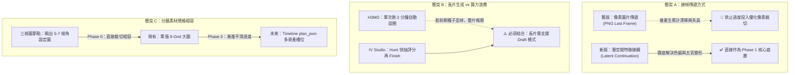
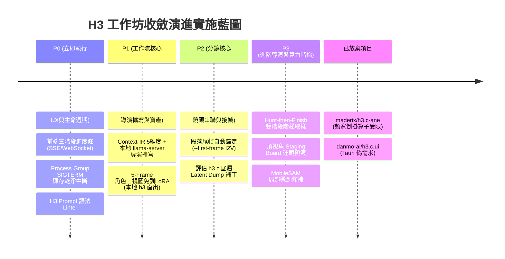

# MiniMax H3 / ComfyUI 影視產片工作流：改進路線與進展實體紀錄

> **文件定位**：本文件為現有 **`film-chain` 工作坊**、**本地 `h3.c` 引擎** 與 **`h3_storyboard_pipeline.py`** 的架構演進藍圖與實體進展追蹤看板。持續整合社群最新技術（IV Studio、H3MD Director、H3-Character-Sheet-Designer 等），並在落地過程中主動化解架構衝突與重工風險。

---

## 一、 Mac / Apple Silicon (Metal) 硬體相容性審查與二次深度源碼盤查

> ⚠️ **關鍵技術背景**：
> 社群 99% 的 ComfyUI 影片工作流是假設在 **Nvidia GPU + CUDA + xFormers / Triton** 環境運行。
> 本專案能在 Mac 上流暢運行，完全是因為採用了**極少數由技術專家手寫的 Apple Silicon Metal 原生 C/Objective-C 引擎（`h3.c` / `libh3.a`）**，並透過 `comfy_h3_bridge` 橋接。
> 本章節結合真實源碼（`antirez/h3.c`）進行嚴格的二次底層工程審查，勘誤技術盲點並補齊遺漏的流水線拼圖。

### 1. 現有盤查項目的「技術盲點與可行性勘誤」
1. **`maderix/h3.c-ane`（高估 ANE 對大型 DiT 承載力 $\to$ 決策：放棄整合）**：
   * **頻寬倒掛**：M 系列 Max/Pro GPU 統一記憶體頻寬達 300~400+ GB/s，而 ANE 快取極小且存取主存頻寬遠遜於 GPU。
   * **算子與動態維度限制**：ANE 嚴格受限於特定形狀與精度，對大型 Transformer 的複雜 Attention、動態解析度與旋轉位置編碼（RoPE）極不友善，會引發頻繁的 CPU/GPU/ANE Context Switch 與記憶體拷貝，速度反而暴跌。
   * **結論**：放棄 DiT 搬上 ANE。DiT 堅決留守 Metal GPU 並專注 Metal Shaders 優化。
2. **`0xSufi/h3.c`（忽略模型權重的 I/O 物理限制 $\to$ 決策：僅作未來雲端備案）**：
   * 純 C/CUDA 執行檔雖僅數十 MB，但 H3 權重檔動輒 15GB~30GB。雲端冷啟動的真正瓶頸在於 NVMe/網路磁碟將數十 GB 權重拉進 VRAM（耗時 5~15 秒）。在沒有 Memory Snapshot 前，無法做到「Sub-second」冷啟動。
3. **`skaiy/h3.c-studio` 的 `libh3.a` 常駐記憶體（OOM 衝突風險 $\to$ 決策：採 Worker Daemon 閒置超時釋放）**：
   * 若將 H3 模型永久鎖定在記憶體，一旦本機同時運行 `llama-server`（載入 27B/30B 模型與 KV Cache），64GB 記憶體會瞬間觸發 macOS Swap 交換，導致整機算力斷崖式雪崩。
   * **策略**：不採用永久鎖死記憶體方案，維持 Worker Daemon（支援 Idle Timeout 自動卸載）或仰賴 macOS `mmap` Page Cache 的零拷貝熱啟動。
4. **`danmo-ai/h3.c.ui` (Tauri)（偏離工作坊核心 $\to$ 決策：直接略過）**：
   * 只是將網頁套上 WKWebView 桌面殼，對提升生成品質與工作流連貫度邊際效益為零，列為最低優先級並放棄。

---

### 2. 二次源碼盤查：`antirez/h3.c` 底層支援度實測驗證

針對「影片工作坊（film-chain）」三大核心拼圖，我們直接深入檢查了本地現有 `antirez/h3.c` 源碼：

#### 拼圖 A：首尾幀控制（I2V / Keyframe Conditioning）與分鏡連貫性
* **源碼現狀**：
  * **支援 I2V 與首尾幀錨定**：`main.c` 與 `h3.c` 原生具備 `--first-frame <image>` 與 `--last-frame <image>`。在 `h3.c:1224` 中，會透過 `h3_ffmpeg_read_image_f32` 讀入並編碼為條件特徵，並設 `keyframes[0] = 0`。
  * **重要限制（互斥規則）**：檢視 `h3.c:591`：
    ```c
    if (params->reference_count && (params->first_frame || params->last_frame)) {
        h3_set_error(ctx, "full references cannot be combined with frame anchors");
        return 0;
    }
    ```
    **全量參考（Ref2VA / `--ref-image`）與首尾幀錨定（FL2VA / `--first-frame`）目前在底層是互斥的！**
  * **原生 Latent CLI 接口缺失**：目前 `h3.c` 命令列未暴露 `--init-latent` 或 `--save-latent`，所有分鏡傳遞目前必須經過圖片檔案（PNG）。

#### 拼圖 B：階段性顯存卸載（Stage-wise Offloading）與 Tiled VAE Decoding
* **源碼現狀**：
  * **階段性主動釋放（Stage-wise Free）**：檢視 `h3.c:1591`，DiT 去噪生成完畢後，**立刻執行 `h3_dit_free(dit); dit = NULL;`**，徹底釋放去噪網路顯存，隨後才載入 Audio VAE 與 Video VAE！
  * **切塊解碼（Tiled VAE）**：檢視 `h3_video_vae.c`，底層已實作空間切塊（`tile_count_for_extent`、`run_resident_tile`）與時間分塊（`decode_chunked`）。因此在 95% VAE 解碼階段已具備切塊防爆機制。

#### 拼圖 C：FFmpeg / 音畫合成串流流水線
* **源碼現狀**：
  * 檢視 `h3_ffmpeg.c:667`，底層透過 `pipe:0`（rawvideo rgb24）與 `pipe:X`（f32le 16kHz audio）建立雙向管道，以 `posix_spawnp` 呼叫 FFmpeg 原生壓製為：
    `-c:v libx264 -preset fast -crf 18 -pix_fmt yuv420p -c:a aac -b:a 192k -movflags +faststart`
  * **結論**：原生輸出的 MP4 已經自帶 `+faststart` 與 `yuv420p`，天生相容網頁串流播放，無須額外重新轉碼。

---

### 3. 各技術模組在 Mac 上的相容性與落地方式評估

| 技術項目 | 社群原版依賴 (Nvidia/CUDA) | Mac (Apple Silicon Metal) 現狀與評估 | 在本機的正確落地策略 |
| :--- | :--- | :--- | :--- |
| **H3 Prompt Linter** (IV Studio) | Python / Ollama / 正則 | 🟢 **100% 原生相容**<br>純文本與 AST 分析，不依賴 GPU 運算架構。 | 直接整合至 `film-chain` 前端或本機 Python 預處理腳本。 |
| **5-Frame 角色三視圖** (Character Sheet) | 調用 ComfyUI 內部 H3 跑 5 幀 | 🟢 **完美相容（底層已支援）**<br>本地 `h3` 二進位檔原生支援 `--frames 5` 與 `--ref-image`。 | **無須安裝社群重型節點**！直接調用本機現成的 `h3` 執行檔跑 5 幀抽第 1 幀。 |
| **結構化提示詞 Context-IR** (H3 Studio) | 前端拆分 Scene/Action/Camera 等 | 🟢 **100% 原生相容**<br>可與本地 `llama-server` 聯動擴寫。 | 前端介面升級，搭配本地 LLM 一鍵自動生成五維度英文 Prompt。 |
| **進度即時解析與 SIGTERM 管控** | 終端 log 監聽與進程管理 | 🟢 **100% 原生相容**<br>Mac 終端標準管線機制。 | 建立 PTY/Subprocess Parser，透過 SSE 推送三階段進度並提供一鍵中斷。 |
| **首尾幀連貫接幀 (I2V)** | 社群 ComfyUI 首尾幀節點 | 🟢 **底層源碼已原生具備**<br>`h3` 原生支援 `--first-frame`。 | 工作坊直接將 Segment $N$ 尾幀提取傳入 Segment $N+1$ 的 `--first-frame`。 |
| **潛空間無損接續** (H3MD Latent) | ComfyUI 內部傳遞 PyTorch Tensor (CUDA Latent) | 🔴 **不可直接照搬 Python 節點**！<br>`h3.c` 尚未暴露 Latent CLI 參數，且強裝 Python 節點會觸發 MPS OOM。 | Phase 1 先採用 `--first-frame` 穩定串接；後續可評估是否對 `h3.c` 打補丁暴露 dump/load latent。 |
| **ANE 硬體卸載** (h3.c-ane) | 私有 ANE API | ❌ **放棄**（頻寬倒掛、動態算子不相容）。 | DiT 堅守 Metal GPU，不引入 ANE 複雜度。 |
| **Tauri 原生桌面端** (h3.c.ui) | Rust + WKWebView | ❌ **放棄**（邊際效益低）。 | 專注 Web 版 `film-chain` 工作坊。 |

---

## 二、 架構衝突防護與防重工規則（Conflict & Anti-Redundancy Rules）

在整合多個開源專案技術時，存在數個關鍵的底層設計衝突。必須遵循以下防護規則，避免寫廢代碼與推倒重來：



### 1. 衝突點 A：接幀方式（像素首尾幀 vs 潛空間接續）
* **衝突現象**：現有 `h3_storyboard_pipeline.py` 採「提取 Segment N 最後 1 幀為 PNG，作為 Segment N+1 的 `--first-frame`」。若先花大量時間去寫 ffmpeg 像素平滑過渡或邊緣修補，一旦升級成 H3MD 的 **Latent Continuation（潛空間接續）**，所有的像素修補代碼將全數作廢。
* **防重工原則**：**禁止在舊版「PNG 圖片首尾幀提取」上堆疊複雜修補邏輯**。接幀演進直接以「潛空間特徵快取與接續」為目標改造。

### 2. 衝突點 B：長片單次運行 vs 算力盲抽浪費
* **衝突現象**：H3MD Director 主打「單次佇列自動跑完 2~3 分鐘」，但 H3 本地生成非常吃算力且具不確定性；若第 10 秒人物崩毀，後續 2 分鐘的顯卡運算皆是浪費。而 IV Studio 提倡「Hunt-then-Finish（低步數快篩 $\to$ 挑中同種子精修）」。
* **防衝突原則**：**單次長片佇列必須內建「Draft 模式」**。前置先以低步數（8~10 steps）快跑全篇分段預覽，經檢驗合格或鎖定種子後，再觸發「同 Latent 高精度完稿」，避免盲目長跑。

### 3. 衝突點 C：資產輸入架構（9-Grid 九宮格 vs Timeline 多槽位）
* **衝突現象**：現有 `film-chain` 深度綁定一張「九宮格拼圖」，而 H3MD 採用時間軸動態資產標籤（`<Picture N>`、`<Video K>`）。
* **防重工原則**：**採取兩階段漸進演進**。
  * **第一階段**：導入 H3-Character-Sheet-Designer 時，將輸出的 5~7 視角設定圖直接映射/裁切為現有的九宮格格式，前端無須傷筋動骨。
  * **第二階段**：待時間軸與多軌架構就緒，再平滑解耦成獨立資產庫（Asset Bin）。

---

## 三、 推薦實施順序與收斂落地路線圖（Action Plan & Roadmap）

經過底層源碼盤查與可行性勘誤後，重新收斂任務優先級，**果斷剔除 ANE 與 Tauri 陷阱**，專注於「即時進度、分鏡串聯、本地 LLM 擴寫、記憶體釋放」四大真需求：



### P0：立即執行（UX 體驗與進程生命週期安全）
> **目標**：解決目前「算圖不知算到哪」、「算錯無法乾淨中斷」、「提示詞寫錯靜默失敗」的三大痛點。
1. **採納 `h3.c-studio` 前端三階段進度解析（Progress Streamer）**：
   * 後端建立 PTY / Subprocess Log Parser，實時監聽 `h3.c` stdout。
   * 透過 SSE / WebSocket 推送精準進度：「文本編碼 (Text Encoding) $\to$ 去噪步數 (Denoising Steps 1..N) $\to$ VAE 切塊解碼 (VAE Tiled Decoding)」。
2. **Process Group SIGTERM 顯存乾淨中斷（Job Cancellation）**：
   * 實作 `kill -TERM -pid`，使用者按停止時立即釋放 Metal Buffer，避免殘留殭屍進程佔用統一記憶體。
3. **H3 Prompt Linter 靜態語法防呆**：
   * 預防性檢查 speaker tags 是否閉合、未綁定的人物標籤與時序矛盾。

### P1：工作流核心（Context-IR 結構化 + 本地 LLM 導演擴寫 + 角色資產）
> **目標**：讓一般使用者輸入一句話，即可自動化產出高對齊度的分鏡與角色一致性圖。
1. **Context-IR 5 維度 + 本地 `llama-server` 導演擴寫**：
   * 前端表單拆解為：**場景 (Scene)、動作 (Action)、鏡頭 (Camera)、影調 (Look)、音訊 (Audio)**。
   * 串接本地現有的 `llama-server`，使用者輸入簡單中文概念，由本地 LLM 自動擴寫這 5 個維度並翻譯為對齊 H3 的高階英文提示詞。
2. **5-Frame 角色三視圖與換裝（本地 `h3` 原生驅動）**：
   * 呼叫本地 `h3 --frames 5 --ref-image`，5 秒內快速生成 5~7 視角角色設定圖，自動裁切適配現有九宮格首幀。

### P2：分鏡串聯與接幀深度架構（Shot Chaining & Latent Continuity）
> **目標**：徹底繞開 `h3.c:591`（`--first-frame` 與 `--ref-image` 互斥且強制切 `FL2VA`）的底層限制，實現雙軌分鏡接力。
1. **分鏡分支模式一：換鏡位 / 切景（New Camera Angle — Henninges Transition Trick）**：
   * 在 `Ref2VA` 模式下，將上一鏡尾幀 `tail_prev.png` 作為額外的 `--ref-image` 傳入（搭配固定角色參考圖 `--ref-image char_sheet.png`），並在 Prompt 標註 `<Picture 1>` 為角色外觀、`<Picture 2>` 為延續自上一鏡的光影與環境。**注意**：需先補齊本地 `Ref2VA DiT` 權重方可啟用。
2. **分鏡分支模式二：一鏡到底 / 連續長鏡頭（Continuous Shot — `--motion-context` / `--first-frame`）**：
   * **潛空間無損接續（已整合 PR #76）**：上一鏡帶 `--save-context seg_N.h3ctx` 儲存 Video + Audio 潛空間；下一鏡帶 `--motion-context seg_N.h3ctx`（或直接傳上一鏡 `.mp4`）釘住最後 22 幀（7 個潛空間步）與 0.917 秒音訊，原生支援 `FL2VA` 模型（免 `Ref2VA` 權重），且可與 `--last-frame` 及 `--ref-image` 共存！
   * **像素首幀備援（I2V 鏈接）**：將上一鏡尾幀傳給 `--first-frame`（可搭配 `--last-frame` 控制落點，不可傳 `--ref-image`）。

### P3：進階導演介面與算力階梯化（Studio Features）
1. **Hunt-then-Finish 雙階段階梯取樣（底層已就緒，已整合 PR #2 / #14 / #73）**：
   * `h3_presets.py` 已定義 `DRAFT`（`--steps 6` 搭配 Turbo LoRA）、`DRAFT_AGGRESSIVE`（`--steps 6 --layers 40 --reuse 2` + 縮小 32 倍數同比例內部畫布 `--render-width / --render-height`）、`DRAFT_FALLBACK`（`--steps 10 --layers 40 --reuse 2`，供尚未折疊 Turbo LoRA 的 `FL2VA` 使用）與 `BALANCED`（`--steps 16` [12~20] `--layers 45 --reuse 2`）。
   * 支援 `--checkpoint-after-step K --checkpoint draft.ckpt` 提前產出草稿預覽，中選後以 `--resume draft.ckpt` 續跑完稿。
2. **頂視角 Staging Board**：2D 軌跡轉方位運鏡 Prompt。
3. **MobileSAM 局部微創修補**：以 CoreML/MPS 輕量模型替代肥大 CUDA SAM。

### 暫緩 / 放棄項目（Declined / Deprecated）
* ❌ **`maderix/h3.c-ane`**：放棄。ANE 記憶體頻寬過低，DiT 動態維度與 RoPE 引起嚴重 Context Switch，得不償失。
* ❌ **`danmo-ai/h3.c.ui` (Tauri)**：放棄。純屬包裝殼，與工作坊核心價值脫節。
* ⏸️ **`0xSufi/h3.c`**：保留為長期雲端極速冷啟動備案。

---

## 四、 實體進展追蹤看板（Living Progress Tracker）

| 編號 | 改善項目 | 借鑑來源 | 影響範圍 | 狀態 | 負責模組 / 標記 |
| :---: | :--- | :--- | :--- | :---: | :--- |
| **Pre-P0** | 上游加速 PR 整合編譯 (#2, #14, #35, #62, #73, #76) | `antirez/h3.c` PRs | C/Metal 核心引擎 | ✅ 已完成 | `h3.c` (`269f13e`, 2002 tests pass) |
| **P0-1** | 非阻塞 `\r` 進度攔截 + Interactive 常駐會話 | `h3.c-studio` / `h3_cli.c` | 後端調度與 ComfyBridge | ✅ 已完成 | `h3_runner.py` / `comfy_h3_bridge` |
| **P0-2** | Process Group (`killpg`) 3s 連坐清理與殘留檔清除 | `h3.c-studio` | 進程生命週期與磁碟衛生 | ✅ 已完成 | `h3_runner.py` / `comfy_h3_bridge` |
| **P0-3** | H3 Prompt 語法與互斥條件防呆檢驗器（Linter） | IV Studio / `h3.c:591` | 前端 / 後端驗證 | ✅ 已完成 | `h3_prompt_linter.py` |
| **P1-1** | Context-IR 5維度 + 本地 llama 擴寫 | H3 Studio | 提示詞工程 | ✅ 已完成 | `h3_context_ir.py` / `promptBuilder.js` / 前端填表 |
| **P1-2** | 5 幀角色三視圖免訓 LoRA 模組 | Character-Sheet | 前置資產 | ✅ 已完成 | `h3_character_sheet.py` (抽第0幀高清圖) |
| **P2-1** | 雙軌分鏡接力（Henninges Ref2VA vs `--motion-context`） | Henninges / PR #76 | 分鏡連貫性 | ✅ 已完成 | `h3_storyboard_pipeline.py` (支援雙模) |
| **P2-2** | `h3.c` 原生潛空間與斷點續跑補丁 (`--save-context`/`--resume`) | PR #2 & PR #76 | 潛空間接續與續跑 | ✅ 已完成 | `h3.c` + `h3_presets.py` + 雙段實測通過 |
| **P3-1** | Hunt-then-Finish 預設參數組合與斷點草稿支援 | IV Studio / PR #2, #14 | 本機算力加速 | ✅ 已完成 | `h3_storyboard_pipeline.py` (`--checkpoint-after-step`/`--resume`) |
| **P3-2** | Staging Board 頂視角運鏡平面板編譯器 | IV Studio | 前端交互 / 運鏡 | ✅ 已完成 | `h3_staging_board.py` (2D軌跡轉Prompt) |
| **P3-3** | MobileSAM 局部微創修補 | IV Studio | 剪輯修復 | 📋 評估中 | CoreML / MPS 分割 |

---

## 五、 知識庫與案例參考索引（Case Studies Archive）

### 案例 01：IV Studio（ComfyUI + MiniMax H3 開源影視工作站）
* **專案網址**：[https://github.com/hollisorg/iv-studio](https://github.com/hollisorg/iv-studio)
* **核心貢獻**：H3 Prompt Linter、Hunt-then-Finish 雙階段階梯渲染、Staging Board 平面機位導引、SAM 3.1 局部修復剪輯、Runpod/Modal 自動關機、142-tool MCP 代理。

### 案例 02：H3MD Director（ComfyUI 超長視頻導演節點包，單次運行 2–3 分鐘 1080P）
* **專案網址**：[https://github.com/1113800942/comfy-h3md-director](https://github.com/1113800942/comfy-h3md-director)
* **展示影片**：[https://youtu.be/plDxnModffs](https://youtu.be/plDxnModffs)
* **核心貢獻**：潛空間無損接續（Latent Continuation）、視覺化時間軸與 `<Picture N>` 資產標籤、自動分段磁碟快取（Disk Caching）、多任務 V2V/R2V/FL2V 混合管線。

### 案例 03：H3-Character-Sheet-Designer（極速角色三視圖與換裝一致性解法）
* **專案網址**：[https://github.com/ukr8b3g-cmyk/H3-Character-Sheet-Designer](https://github.com/ukr8b3g-cmyk/H3-Character-Sheet-Designer)
* **核心貢獻**：免訓 LoRA「跑 5 幀抽第 1 幀」降維思維、1 主圖 + 3 部位槽位 + 8 身體部位 micro-prompt、關閉 Layout 白模避坑、5~7 核心視角最佳實踐。

---

### 案例 04：`antirez/h3.c` 開源生態圈 Fork 與關鍵技術補強盤點

> 本地所使用的 C/Metal 引擎源自 Redis 創始人 Salvatore Sanfilippo 的 [`antirez/h3.c`](https://github.com/antirez/h3.c)。
> 社群圍繞該專案進行了多個針對 Apple Silicon 與專用硬體的 Fork，提供了極高參考價值的補強方案：

#### 1. `skaiy/h3.c-studio`（H3 Studio - 本地 Web GUI 與分鏡工作站）
* **專案網址**：[https://github.com/skaiy/h3.c-studio](https://github.com/skaiy/h3.c-studio)
* **技術架構**：React + TypeScript + Tailwind CSS + FastAPI 後端包裝 `h3.c`。
* **可直接移植到 `film-chain` 的功能**：
  * **結構化提示詞（Context-IR）**：將單一 prompt 輸入框拆解為「場景 (Scene)、動作 (Action)、鏡頭 (Camera)、影調 (Look)、音訊 (Audio)」獨立欄位，大幅降低語意混亂。
  * **三階段即時進度解析**：透過正則解析 `h3` 二進位的 stdout 串流，即時呈現「文本編碼 (Text Encoding) $\to$ 去噪步數 (Denoising Steps) $\to$ VAE 解碼 (VAE Decoding)」，讓使用者在 Mac 上清楚掌握進度。
  * **串行 GPU 任務隊列與即時中斷（Job Cancellation）**：提供一鍵中斷按鈕，即時發送 `SIGTERM` 釋放 Metal 顯存。
  * **規劃中的 `libh3.a` C-Bindings**：擺脫每次透過 subprocess 重新冷啟動，直接常駐記憶體模型以提升後續分段速度。

#### 2. `maderix/h3.c-ane`（Apple Neural Engine ANE 硬體離線加速 Fork）
* **專案網址**：[https://github.com/maderix/h3.c-ane](https://github.com/maderix/h3.c-ane)
* **技術突破**：
  * 透過逆向工程調用 Apple Silicon 私有 ANE API，嘗試將 MiniMax H3 的 Diffusion Transformer (DiT) 模組直接**卸載到 Apple 類神經引擎（NPU / ANE）**上運行。
  * **對 Mac 本機的價值**：釋放原本被 DiT 佔滿的 Metal GPU 頻寬與統一記憶體算力，大幅降低發熱與降頻風險，為後續超分或多任務並行騰出 GPU 空間。

#### 3. `danmo-ai/h3.c.ui`（Tauri 原生桌面包裝）
* **專案網址**：[https://github.com/danmo-ai/h3.c.ui](https://github.com/danmo-ai/h3.c.ui)
* **技術架構**：採用 Rust + Tauri 架構包裝 `libh3`，提供 macOS 原生視窗化介面，相較於瀏覽器網頁端更輕量、資源開銷更低。

#### 4. `0xSufi/h3.c`（CUDA / DGX 移植版）
* **專案網址**：[https://github.com/0xSufi/h3.c](https://github.com/0xSufi/h3.c)
* **技術價值**：
  * 將 `antirez/h3.c` 的極簡純 C 架構移植到 NVIDIA CUDA。
  * **對我們雲端調度的啟發**：若要在 Modal/RunPod 上部署雲端算力，無須安裝數十 GB 龐大的 PyTorch/CUDA 容器，直接編譯這份輕量 C/CUDA 二進位檔即可極速冷啟動執行。

