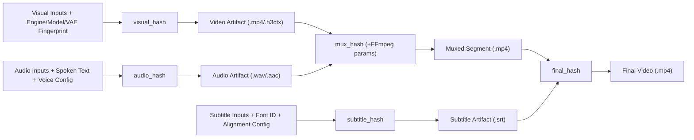

# H3C V2 實體微批次執行計劃（3.8 Flash 傻瓜化接力手冊：F0 ～ F9）

> **⚡ 3.8 Flash 執行鐵律（違反任一條立即停止）**：
> 1. **禁止整檔讀取 `>200` 行檔案**：對 `index.html`、`h3_storyboard_pipeline.py`、`h3.c` 必先用 `grep -n` 定位行號，再用 `read_file` 讀取 `±40` 行切片。
> 2. **對 `film-chain/` 下所有檔案一律使用原生 `read_file` / `edit_file` / `write_file` 工具**（禁止在 bash 中直接 cat/sed 修改 `film-chain/public/src/core/*.js`）。
> 3. **Python 3.9 相容與 Ruff 紅線**：所有新 `.py` 檔第一行必須是模組 docstring，緊接著 `from __future__ import annotations`（置於其他 import 之前）；函式參數 `>3` 個必須封裝為 `@dataclass(frozen=True)`；單一函式 statements `<=50`；縮排 `<=3` 層；禁止空 `except: pass`。
> 4. **【防崩潰核心鐵律】強制雙檔進度同步（Dual-File Doc Sync Gate）**：
>    - 3.8 Flash 容易只改程式碼卻忘記更新文件，導致下一輪記憶重置後重做或狀態錯亂。
>    - 因此，**每一個子步驟（Sub-Step）都包含強制性的「📝 進度文件同步動作」與「🔍 驗證指令（含 `grep` 檢查文件已打勾）」**！
>    - 每次只准執行 **1 個子步驟**：改完程式碼 $\to$ 跑通過測試與 Ruff $\to$ 用 `edit_file` 將 `docs/dev/STATE.md` 與 `docs/dev/V2_EXECUTION_PLAN.md` 對應步驟的 `- [ ]` 改為 `- [x]`（`STATE.md` 嚴禁超過 50 行、禁止追加長篇敘事）$\to$ 執行含文件打勾斷言的最終驗證指令 $\to$ 才能進入下一步！

---

## 階段 F0：核心技術可行性受控實驗與前置環境對齊

- [x] `F0-1` **H3 `256×160` 代理畫布物理耗時與聲紋實測**
  - **實測結論**：`256×160 --token-reduction` 將 DiT 6 步聯合去噪從 `1,633.22s` 壓縮至 **`95.46s`**（加速 17.1 倍），且 `video VAE decoder`（1×1 tile）僅耗時 **`7.91s`**，全段總耗時 **`127.19s`（2 分 07 秒）**，完全無需修改 `h3.c` 底層程式碼。
- [x] `F0-2` **H3 代理音軌 vs 獨立 TTS 音軌之客觀量化對比**
  - **實測結論**：H3 代理音軌與原片長度零誤差（`4.250000s`），與 `part14` / `part15_orig` 頻譜餘弦相似度高達 **`0.9673` / `0.9706`** 且完整保留場景音效與 BGM；獨立 TTS 長度 `5.801s`（誤差 `1.551s`）且缺失 BGM 導致背景配樂斷層（相似度僅 `0.303`）。
- [x] `F0-3` **中文 Character-Level 時間戳與 VAD 能量包絡對齊實測**
  - **實測結論**：確立 `ffprobe` 容器時長鎖定 + 200Hz–3800Hz 人聲頻帶 VAD + 中文字符與標點停頓權重對齊（`vad_char_weighted`）為無外部 ASR 模型時的標準演算法（詳見 `docs/dev/F0_AUDIO_AND_ALIGNMENT_REPORT.md`）。

- [x] `F0-BRANCH` **建立 V2 專屬開發分支 `feat/v2-architecture-upgrade` 並提交基準文件**
  - **動作內容**：
    1. 執行 `git checkout -b feat/v2-architecture-upgrade`（若已存在則 `git checkout feat/v2-architecture-upgrade`），確保 `main` 主幹不受大版本重構影響。
    2. 用 `edit_file` 將 `docs/dev/STATE.md` 與 `docs/dev/V2_EXECUTION_PLAN.md` 的 `- [ ] \`F0-BRANCH\`` 改為 `- [x] \`F0-BRANCH\``。
    3. 將規劃與實驗基準文件納入版本控制：`git add AGENTS.md docs/dev/STATE.md docs/dev/V2_EXECUTION_PLAN.md docs/dev/F0_AUDIO_AND_ALIGNMENT_REPORT.md && git commit -m "docs(v2): initialize feat/v2-architecture-upgrade branch and F0 report"`。
  - **🔍 驗證與文件打勾斷言指令**：
    `test "$(git branch --show-current)" = "feat/v2-architecture-upgrade" && grep -q "\- \[x\] \`F0-BRANCH\`" docs/dev/STATE.md && grep -q "\- \[x\] \`F0-BRANCH\`" docs/dev/V2_EXECUTION_PLAN.md && test $(wc -l < docs/dev/STATE.md) -le 50`

- [x] `F0-PRE` **修復既有環境斷點（對齊 `resolve_checkpoint_dir` 與 Pillow 測試環境）**
  - **程式碼檔案**：`tests/test_edu_workflow.py`（讀取 `L65-75`）、`pipeline/h3_subtitles.py`（讀取 `L1-20`）
  - **修改內容**：
    1. 修正 `tests/test_edu_workflow.py:65-73` 的 `test_resolve_checkpoint_dir`：對齊 `h3_edu_profile.resolve_checkpoint_dir()` 的真實規格（當傳入 `base_p / "FL2VA"` 或包含 `FL2VA/` 子目錄的 `base_p` 時，一律回傳包含 `FL2VA/` 的根目錄 `base_p`，因為 `h3.c` 需要從根目錄讀取 `FL2VA/` 與 `video_vae/`）。
    2. 在 `pipeline/h3_subtitles.py` 中，為 `PIL` 提供輕量 fallback 或確保在無 `PIL` 的純標準庫環境下匯入不會直接崩潰，並確認所有測試在 `/opt/homebrew/Caskroom/miniforge/base/bin/python3`（含完整 `PIL`/`scipy`/`numpy`）與 `.venv/bin/python` 皆可 100% 通過。
  - **📝 進度文件同步動作（必做）**：
    1. 用 `edit_file` 將 `docs/dev/STATE.md` 中的 `- [ ] \`F0-PRE\`` 改為 `- [x] \`F0-PRE\``。
    2. 用 `edit_file` 將本檔（`docs/dev/V2_EXECUTION_PLAN.md`）中的 `- [ ] \`F0-PRE\`` 改為 `- [x] \`F0-PRE\``。
  - **🔍 驗證與文件打勾斷言指令**：
    `/opt/homebrew/Caskroom/miniforge/base/bin/python3 -m unittest discover -s tests && .venv/bin/ruff check pipeline/ tests/ && grep -q "\- \[x\] \`F0-PRE\`" docs/dev/STATE.md && grep -q "\- \[x\] \`F0-PRE\`" docs/dev/V2_EXECUTION_PLAN.md && test $(wc -l < docs/dev/STATE.md) -le 50`

---

## 階段 F1：五節點 Artifact DAG 分層雜湊與快取依賴管理

- [x] `F1-1` **於 `pipeline/h3_state.py` 實作環境指紋與五節點 `ShotArtifactHashes`**
  - **程式碼檔案**：`pipeline/h3_state.py`（讀取 `L1-144`）
  - **修改內容**：
    1. 將 `STATE_SCHEMA_VERSION` 升為 `2`（保留 `from_dict` 對 `v1` 的向下相容讀取）。
    2. 新增 `@dataclass(frozen=True) class EnvironmentFingerprints`：收集 `engine_sha256`（`h3` 二進位檔大小與 mtime/前 64KB hash）、`model_fingerprint`（模型目錄下 `.safetensors` 檔案清單與大小摘要）、`prompt_template_version = "v2.0"`、`ffmpeg_mux_signature = "c:v_copy_c:a_aac_192k"`。
    3. 新增 `@dataclass(frozen=True) class ShotArtifactHashes`：包含 `visual_hash: str`, `audio_hash: str`, `mux_hash: str`, `subtitle_hash: str`, `final_hash: str`。
    4. 新增純函式 `compute_shot_artifact_hashes(seg: dict, profile_dict: dict, render_cfg: dict, env_fp: EnvironmentFingerprints | None = None) -> ShotArtifactHashes`：
       - `visual_hash`：雜湊視覺描述（剝除 `<d>...</d>` 對白標籤後的純視覺 Prompt）、`first_frame`、`last_frame`、`chain_mode`、`width`、`height`、`frames`、`steps`、`layers`、`reuse`、`seed`、`engine_sha256`、`model_fingerprint`。
       - `audio_hash`：雜湊 `spoken_dialogue`（若無則取 `<d>` 內容或 `dialogue`）、`acoustic_anchor`、`bgm_style`、`frames`、`seed`、`model_fingerprint`。
       - `mux_hash`：雜湊 `visual_hash + audio_hash + ffmpeg_mux_signature`。
       - `subtitle_hash`：雜湊 `display_dialogue`（若無則取 `dialogue`）、`subtitle_segments`、`font_id`。
       - `final_hash`：雜湊 `mux_hash + subtitle_hash + burn_subtitles_flag`。
  - **📝 進度文件同步動作（必做）**：
    1. 用 `edit_file` 將 `docs/dev/STATE.md` 中的 `- [ ] \`F1-1\`` 改為 `- [x] \`F1-1\``。
    2. 用 `edit_file` 將 `docs/dev/V2_EXECUTION_PLAN.md` 中的 `- [ ] \`F1-1\`` 改為 `- [x] \`F1-1\``。
  - **🔍 驗證與文件打勾斷言指令**：
    `/opt/homebrew/Caskroom/miniforge/base/bin/python3 -m unittest discover -s tests && .venv/bin/ruff check pipeline/h3_state.py && grep -q "\- \[x\] \`F1-1\`" docs/dev/STATE.md && grep -q "\- \[x\] \`F1-1\`" docs/dev/V2_EXECUTION_PLAN.md && test $(wc -l < docs/dev/STATE.md) -le 50`

- [x] `F1-2` **實作快取失效判定器 `evaluate_shot_invalidation` 與 8 情境測試**
  - **程式碼檔案**：`pipeline/h3_state.py`、新增 `tests/test_artifact_cache_graph.py`
  - **修改內容**：
    1. 新增 `@dataclass(frozen=True) class ShotInvalidationPlan`：含布林欄位 `rerun_video: bool`, `rerun_audio: bool`, `rerun_mux: bool`, `rerun_subtitle: bool`, `rerun_final: bool`。
    2. 新增 `evaluate_shot_invalidation(prev_hashes: ShotArtifactHashes | None, curr_hashes: ShotArtifactHashes, upstream_video_changed: bool = False, uses_motion_context: bool = False) -> ShotInvalidationPlan`：
       - 若 `upstream_video_changed` 為 True 且 `uses_motion_context` 為 True，強制 `rerun_video = True`。
       - 若僅 `subtitle_hash` 改變：`rerun_video=False, rerun_audio=False, rerun_mux=False, rerun_subtitle=True, rerun_final=True`。
       - 若僅 `audio_hash` 改變：`rerun_video=False, rerun_audio=True, rerun_mux=True, rerun_subtitle=True, rerun_final=True`。
    3. 於 `tests/test_artifact_cache_graph.py` 編寫完整 8 種修改情境（含模型指紋變更、上游 `motion_context` 連鎖失效、僅改 `display_dialogue`、僅改 `spoken_dialogue`）的單元測試。
  - **📝 進度文件同步動作（必做）**：
    1. 用 `edit_file` 將 `docs/dev/STATE.md` 中的 `- [ ] \`F1-2\`` 改為 `- [x] \`F1-2\``。
    2. 用 `edit_file` 將 `docs/dev/V2_EXECUTION_PLAN.md` 中的 `- [ ] \`F1-2\`` 改為 `- [x] \`F1-2\``。
  - **🔍 驗證與文件打勾斷言指令**：
    `/opt/homebrew/Caskroom/miniforge/base/bin/python3 -m unittest tests/test_artifact_cache_graph.py && /opt/homebrew/Caskroom/miniforge/base/bin/python3 -m unittest discover -s tests && .venv/bin/ruff check pipeline/h3_state.py tests/test_artifact_cache_graph.py && grep -q "\- \[x\] \`F1-2\`" docs/dev/STATE.md && grep -q "\- \[x\] \`F1-2\`" docs/dev/V2_EXECUTION_PLAN.md && test $(wc -l < docs/dev/STATE.md) -le 50`

- [x] `F1-3` **將分層 Hash 接入 `pipeline/h3_storyboard_pipeline.py`**
  - **程式碼檔案**：`pipeline/h3_storyboard_pipeline.py`（切片讀取 `L825-990`）
  - **修改內容**：
    1. 在 `state.completed_segments[str_idx]` 中儲存 `"artifact_hashes": asdict(shot_hashes)`。
    2. 當 `loaded_state` 存在時，不再因為單一頂層 `cfg_hash` 不同而清空無關段落的快取，改為若段落已有舊 `artifact_hashes` 則呼叫 `evaluate_shot_invalidation()` 判斷該鏡是否可重用既有 `Video Artifact`（同時保留舊版無 `artifact_hashes` 時對 `config_hash` 的向下相容行為）。
  - **📝 進度文件同步動作（必做）**：
    1. 用 `edit_file` 將 `docs/dev/STATE.md` 中的 `- [ ] \`F1-3\`` 改為 `- [x] \`F1-3\``。
    2. 用 `edit_file` 將 `docs/dev/V2_EXECUTION_PLAN.md` 中的 `- [ ] \`F1-3\`` 改為 `- [x] \`F1-3\``。
  - **🔍 驗證與文件打勾斷言指令**：
    `/opt/homebrew/Caskroom/miniforge/base/bin/python3 -m unittest discover -s tests && .venv/bin/ruff check pipeline/h3_storyboard_pipeline.py && grep -q "\- \[x\] \`F1-3\`" docs/dev/STATE.md && grep -q "\- \[x\] \`F1-3\`" docs/dev/V2_EXECUTION_PLAN.md && test $(wc -l < docs/dev/STATE.md) -le 50`

---

## 階段 F2：Manifest 語音／字幕雙軌與受控發音正規化

- [x] `F2-1` **建立受控三層發音正規化器 `pipeline/h3_phonetic_normalizer.py`**
  - **程式碼檔案**：新增 `pipeline/h3_phonetic_normalizer.py`、擴充 `configs/pronunciation_lexicon.json`、新增 `tests/test_phonetic_normalizer.py`
  - **修改內容**：
    1. 新增 `@dataclass(frozen=True) class PronunciationOverride` (`original: str`, `replacement: str`, `reason: str`) 與 `@dataclass(frozen=True) class NormalizedDialogueResult` (`display_dialogue: str`, `spoken_dialogue: str`, `pronunciation_overrides: tuple[PronunciationOverride, ...]`, `diagnostic_warnings: tuple[str, ...]`)。
    2. 實作第一層 `normalize_numbers_and_units(text: str) -> tuple[str, list[PronunciationOverride]]`：處理百分比（`15.5%` $\to$ `百分之十五點五`）、年份與小數。
    3. 實作第二層：讀取 `configs/pronunciation_lexicon.json` 經人工確認之完整詞組（如 `作業成本`、`資本權重`、`資金調撥`、`會計系統`），絕不單字盲換。
    4. 實作第三層：套用 Shot 內顯式指定的 `pronunciation_overrides` 清單；若環境裝有 `pypinyin` 僅作唯讀診斷填入 `diagnostic_warnings`，無 `pypinyin` 時安靜跳過。
  - **📝 進度文件同步動作（必做）**：
    1. 用 `edit_file` 將 `docs/dev/STATE.md` 中的 `- [ ] \`F2-1\`` 改為 `- [x] \`F2-1\``。
    2. 用 `edit_file` 將 `docs/dev/V2_EXECUTION_PLAN.md` 中的 `- [ ] \`F2-1\`` 改為 `- [x] \`F2-1\``。
  - **🔍 驗證與文件打勾斷言指令**：
    `/opt/homebrew/Caskroom/miniforge/base/bin/python3 -m unittest tests/test_phonetic_normalizer.py && /opt/homebrew/Caskroom/miniforge/base/bin/python3 -m unittest discover -s tests && .venv/bin/ruff check pipeline/h3_phonetic_normalizer.py tests/test_phonetic_normalizer.py && grep -q "\- \[x\] \`F2-1\`" docs/dev/STATE.md && grep -q "\- \[x\] \`F2-1\`" docs/dev/V2_EXECUTION_PLAN.md && test $(wc -l < docs/dev/STATE.md) -le 50`

- [x] `F2-2` **接入 `pipeline/h3_edu_profile.py` 雙軌欄位並維持舊版相容**
  - **程式碼檔案**：`pipeline/h3_edu_profile.py`（讀取 `L57-201`）
  - **修改內容**：
    1. 新增 `resolve_shot_dialogues(shot: dict, lang_code: str = "zh-TW") -> NormalizedDialogueResult`：若 `shot` 已提供 `display_dialogue` / `spoken_dialogue` 則優先尊重；若僅提供 `dialogue` 則自動衍生雙軌。
    2. `compile_shot_prompt()` 嚴格使用 `spoken_dialogue` 寫入 `<d>[Chinese] ...</d>`，且 `calculate_optimal_frames()` 以 `spoken_dialogue` 的實際發音字數計算幀數。
  - **📝 進度文件同步動作（必做）**：
    1. 用 `edit_file` 將 `docs/dev/STATE.md` 中的 `- [ ] \`F2-2\`` 改為 `- [x] \`F2-2\``。
    2. 用 `edit_file` 將 `docs/dev/V2_EXECUTION_PLAN.md` 中的 `- [ ] \`F2-2\`` 改為 `- [x] \`F2-2\``。
  - **🔍 驗證與文件打勾斷言指令**：
    `/opt/homebrew/Caskroom/miniforge/base/bin/python3 -m unittest discover -s tests && .venv/bin/ruff check pipeline/h3_edu_profile.py && grep -q "\- \[x\] \`F2-2\`" docs/dev/STATE.md && grep -q "\- \[x\] \`F2-2\`" docs/dev/V2_EXECUTION_PLAN.md && test $(wc -l < docs/dev/STATE.md) -le 50`

---

## 階段 F3：零漂移 CJK 字幕系統、中文字符級時間軸與軟硬封裝

- [x] `F3-A1` **CJK 字體 `getmask` 實測載入驗證與動態畫布排版**
  - **程式碼檔案**：`pipeline/h3_subtitles.py`（讀取 `L1-119`）
  - **修改內容**：
    1. 新增 `resolve_verified_cjk_font(font_size: int) -> tuple[ImageFont.FreeTypeFont | ImageFont.ImageFont, str]`：依序探測 `H3_SUBTITLE_FONT`、`PingFang.ttc`、`STHeiti Medium.ttc`、`Arial Unicode.ttf`、`NotoSansCJK-Regular.ttc`；載入後強制執行 `mask = font.getmask("測試中文")` 確認 `mask.size[0] > 0`，回傳字體物件與字體檔指紋 `font_id`。
    2. 新增 `probe_media_streams(video_path: Path) -> MediaStreamInfo`（透過 `ffprobe` 取得精確 `width`, `height`, `video_duration_sec`, `audio_duration_sec`）。
    3. `render_subtitle_card()` 支援依影片實際 `(width, height)` 動態縮放字級，並在單行超寬時自動切成雙行居中繪製。
  - **📝 進度文件同步動作（必做）**：
    1. 用 `edit_file` 將 `docs/dev/STATE.md` 中的 `- [ ] \`F3-A1\`` 改為 `- [x] \`F3-A1\``。
    2. 用 `edit_file` 將 `docs/dev/V2_EXECUTION_PLAN.md` 中的 `- [ ] \`F3-A1\`` 改為 `- [x] \`F3-A1\``。
  - **🔍 驗證與文件打勾斷言指令**：
    `/opt/homebrew/Caskroom/miniforge/base/bin/python3 -m unittest discover -s tests && .venv/bin/ruff check pipeline/h3_subtitles.py && grep -q "\- \[x\] \`F3-A1\`" docs/dev/STATE.md && grep -q "\- \[x\] \`F3-A1\`" docs/dev/V2_EXECUTION_PLAN.md && test $(wc -l < docs/dev/STATE.md) -le 50`

- [x] `F3-A2` **中文 Character-Level 時間戳與兩階段語音對齊引擎**
  - **程式碼檔案**：`pipeline/h3_subtitles.py`、新增 `tests/test_subtitles_alignment.py`
  - **修改內容**：
    1. 新增 `@dataclass(frozen=True) class CharTimestamp` (`char: str`, `start: float`, `end: float`) 與 `@dataclass(frozen=True) class ShotSubtitleTrack` (`shot_id: str`, `start_frame: int`, `end_frame: int`, `display_dialogue: str`, `alignment_method: str`, `subtitle_segments: tuple[SubtitleCue, ...]`)。
    2. 實作標點與語意切卡器 `split_cjk_dialogue_into_cards(text: str, max_chars: int = 22) -> list[str]`。
    3. 實作兩階段時間軸 `align_shot_subtitles()`：
       - 若有字級強制對齊器 callback 則標記 `alignment_method="forced_align"`。
       - 否則使用 WAV 能量包絡 / `silencedetect` 找出真實發聲起訖 `[speech_onset, speech_offset]`，按「中文字符權重 1.0 + 標點停頓權重（逗號 0.38、頓號 0.25、句號/問號/驚嘆號 0.55）」分配每個中文字的 Character-Level 時間戳，再聚合為 `subtitle_segments`，標記 `alignment_method="vad_char_weighted"`。
  - **📝 進度文件同步動作（必做）**：
    1. 用 `edit_file` 將 `docs/dev/STATE.md` 中的 `- [ ] \`F3-A2\`` 改為 `- [x] \`F3-A2\``。
    2. 用 `edit_file` 將 `docs/dev/V2_EXECUTION_PLAN.md` 中的 `- [ ] \`F3-A2\`` 改為 `- [x] \`F3-A2\``。
  - **🔍 驗證與文件打勾斷言指令**：
    `/opt/homebrew/Caskroom/miniforge/base/bin/python3 -m unittest tests/test_subtitles_alignment.py && /opt/homebrew/Caskroom/miniforge/base/bin/python3 -m unittest discover -s tests && .venv/bin/ruff check pipeline/h3_subtitles.py tests/test_subtitles_alignment.py && grep -q "\- \[x\] \`F3-A2\`" docs/dev/STATE.md && grep -q "\- \[x\] \`F3-A2\`" docs/dev/V2_EXECUTION_PLAN.md && test $(wc -l < docs/dev/STATE.md) -le 50`

- [x] `F3-B` **音視訊時長差 `apad` 安全檢查與 `mov_text` 軟/硬字幕封裝**
  - **程式碼檔案**：`pipeline/h3_subtitles.py`、`pipeline/h3_storyboard_pipeline.py`（切片讀取 `L660-740`）、新增 `tests/test_subtitles_muxing.py`
  - **修改內容**：
    1. 新增 `mux_soft_subtitles_mp4(video_path: Path, srt_path: Path, output_path: Path) -> Path`：明確執行 `ffmpeg -y -i video -i srt -map 0:v:0 -map 0:a:0? -map 1:s:0 -c:v copy -c:a copy -c:s mov_text -metadata:s:s:0 language=zho output`。
    2. 新增 `reconcile_av_duration(video_path: Path, audio_path: Path, output_path: Path) -> Path`：先用 `probe_media_streams` 檢查視訊與音訊秒數差，音訊較短時加 `-af apad` 對齊視訊長度，**嚴禁盲目用 `-shortest` 切斷說話尾音**。
    3. 修改 `_apply_manifest_subtitles()`：優先從各段 `display_dialogue` 與已落盤 `.mp4` 的真實 `ffprobe` 秒數建立零漂移字幕軌；支援 `mov_text` 軟字幕與 `burn_subtitles` 硬字幕燒錄。
  - **📝 進度文件同步動作（必做）**：
    1. 用 `edit_file` 將 `docs/dev/STATE.md` 中的 `- [ ] \`F3-B\`` 改為 `- [x] \`F3-B\``。
    2. 用 `edit_file` 將 `docs/dev/V2_EXECUTION_PLAN.md` 中的 `- [ ] \`F3-B\`` 改為 `- [x] \`F3-B\``。
  - **🔍 驗證與文件打勾斷言指令**：
    `/opt/homebrew/Caskroom/miniforge/base/bin/python3 -m unittest tests/test_subtitles_muxing.py && /opt/homebrew/Caskroom/miniforge/base/bin/python3 -m unittest discover -s tests && .venv/bin/ruff check pipeline/h3_subtitles.py pipeline/h3_storyboard_pipeline.py tests/test_subtitles_muxing.py && grep -q "\- \[x\] \`F3-B\`" docs/dev/STATE.md && grep -q "\- \[x\] \`F3-B\`" docs/dev/V2_EXECUTION_PLAN.md && test $(wc -l < docs/dev/STATE.md) -le 50`

---

## 階段 F4：數據分級 Telemetry 與五態 Colab Watchdog

- [x] `F4-1` **建立數據可信度分級之 `pipeline/h3_telemetry.py`**
  - **程式碼檔案**：新增 `pipeline/h3_telemetry.py`、新增 `tests/test_telemetry_and_watchdog.py`
  - **修改內容**：
    1. 實作 `@dataclass(frozen=True) class SpecGroupKey` (`gpu_model: str`, `resolution: str`, `frames: int`, `mode: str`)。
    2. 實作 `@dataclass(frozen=True) class TelemetrySnapshot`：
       - 實測欄位（`measured`）：`completed_segments`, `total_segments`, `current_segment_step`, `current_segment_total_steps`, `last_segment_seconds`。
       - 分組統計與推估欄位（`estimated`）：依同 `SpecGroupKey` 歷史樣本計算 `avg_segment_seconds`、`remaining_minutes`、`eta_status` (`"estimated" | "insufficient_samples"`)、`eta_confidence` (`"high" | "medium" | "low"`)。
       - 外部欄位（`external`）：`cu_balance: float | None`、`cu_balance_status` (`"available" | "stale" | "unknown"`)，**嚴禁自行扣減推算餘額**。
    3. 實作原子寫入 `write_telemetry_snapshot(output_dir: Path, snapshot: TelemetrySnapshot) -> Path`。
  - **📝 進度文件同步動作（必做）**：
    1. 用 `edit_file` 將 `docs/dev/STATE.md` 中的 `- [ ] \`F4-1\`` 改為 `- [x] \`F4-1\``。
    2. 用 `edit_file` 將 `docs/dev/V2_EXECUTION_PLAN.md` 中的 `- [ ] \`F4-1\`` 改為 `- [x] \`F4-1\``。
  - **🔍 驗證與文件打勾斷言指令**：
    `/opt/homebrew/Caskroom/miniforge/base/bin/python3 -m unittest tests/test_telemetry_and_watchdog.py && /opt/homebrew/Caskroom/miniforge/base/bin/python3 -m unittest discover -s tests && .venv/bin/ruff check pipeline/h3_telemetry.py tests/test_telemetry_and_watchdog.py && grep -q "\- \[x\] \`F4-1\`" docs/dev/STATE.md && grep -q "\- \[x\] \`F4-1\`" docs/dev/V2_EXECUTION_PLAN.md && test $(wc -l < docs/dev/STATE.md) -le 50`

- [x] `F4-2` **收編通用化五態 `pipeline/h3_colab_watchdog.py`（含 `STALLED` 偵測）**
  - **程式碼檔案**：新增 `pipeline/h3_colab_watchdog.py`、擴充 `tests/test_telemetry_and_watchdog.py`
  - **修改內容**：
    1. 定義五態常數：`RUNNING`, `STALLED`, `RECOVERING`, `COMPLETED`, `FAILED`。
    2. 實作五維度健康探針 `evaluate_watchdog_health(proc_alive, session_alive, progress_updated_ago_sec, max_stall_sec, output_count)`：**即使 `proc_alive` 與 `session_alive` 皆為 True，只要 `progress_updated_ago_sec > max_stall_sec`，立即判定為 `STALLED`（假活著）** 並進入 `RECOVERING`。
    3. 實作 `is_gpu_capacity_503(stderr_text: str) -> bool`：僅當錯誤包含容量/配額關鍵字（`RESOURCE_EXHAUSTED`, `accelerator`, `stockout`, `A100`）時才允許 `A100 -> L4` 降級。
    4. 移除所有硬編碼路徑，支援 CLI 參數 `--manifest`, `--output-dir`, `--gpu`, `--min-cu`, `--cold-stall-sec`, `--warm-stall-sec`。
  - **📝 進度文件同步動作（必做）**：
    1. 用 `edit_file` 將 `docs/dev/STATE.md` 中的 `- [ ] \`F4-2\`` 改為 `- [x] \`F4-2\``。
    2. 用 `edit_file` 將 `docs/dev/V2_EXECUTION_PLAN.md` 中的 `- [ ] \`F4-2\`` 改為 `- [x] \`F4-2\``。
  - **🔍 驗證與文件打勾斷言指令**：
    `/opt/homebrew/Caskroom/miniforge/base/bin/python3 -m unittest tests/test_telemetry_and_watchdog.py && /opt/homebrew/Caskroom/miniforge/base/bin/python3 -m unittest discover -s tests && .venv/bin/ruff check pipeline/h3_colab_watchdog.py tests/test_telemetry_and_watchdog.py && grep -q "\- \[x\] \`F4-2\`" docs/dev/STATE.md && grep -q "\- \[x\] \`F4-2\`" docs/dev/V2_EXECUTION_PLAN.md && test $(wc -l < docs/dev/STATE.md) -le 50`

---

## 階段 F5：確定性 Agent 唯一主入口 `pipeline/h3_cli.py` 與四級防呆 Skill

- [x] `F5-1` **實作 `pipeline/h3_cli.py`：Manifest 驗證、表格編譯與語意切片 `digest`**
  - **程式碼檔案**：新增 `pipeline/h3_cli.py`、新增 `tests/test_h3_cli.py`
  - **修改內容**：
    1. 子指令 `validate-manifest --manifest <path>`：檢查雙軌欄位、幀數合法性、錨點圖存在性與五節點 Hash 狀態。
    2. 子指令 `build-manifest --from-table <md/tsv> --track <local_5s|colab_12s> --output <json>`：將簡單表格確定性編譯為完整 JSON Manifest（自動執行 F2 雙軌正規化）。
    3. 子指令 `digest --input <doc_path> --max-chars 1000`：優先按 Markdown `#` 標題、空行段落與表格邊界切分語意區塊，絕不切斷句子或表格。
  - **📝 進度文件同步動作（必做）**：
    1. 用 `edit_file` 將 `docs/dev/STATE.md` 中的 `- [ ] \`F5-1\`` 改為 `- [x] \`F5-1\``。
    2. 用 `edit_file` 將 `docs/dev/V2_EXECUTION_PLAN.md` 中的 `- [ ] \`F5-1\`` 改為 `- [x] \`F5-1\``。
  - **🔍 驗證與文件打勾斷言指令**：
    `/opt/homebrew/Caskroom/miniforge/base/bin/python3 -m unittest tests/test_h3_cli.py && /opt/homebrew/Caskroom/miniforge/base/bin/python3 -m unittest discover -s tests && .venv/bin/ruff check pipeline/h3_cli.py tests/test_h3_cli.py && grep -q "\- \[x\] \`F5-1\`" docs/dev/STATE.md && grep -q "\- \[x\] \`F5-1\`" docs/dev/V2_EXECUTION_PLAN.md && test $(wc -l < docs/dev/STATE.md) -le 50`

- [x] `F5-2` **實作 `resolve-anchor` 四級防呆梯、`render-slide` 與更新 `SKILL.md`**
  - **程式碼檔案**：`pipeline/h3_cli.py`、`.agents/skills/h3c-local-film-chain/SKILL.md`
  - **修改內容**：
    1. 子指令 `render-slide --title "..." --bullets "..." --output <png>`：使用 Pillow + 實測 CJK 字體繪製 `1376×768` / `864×480` 教學圖表卡。
    2. 子指令 `resolve-anchor --role <speaker|slide|scene> --query "..."`：
       - 若 `role == "slide"` 且無外部圖：直接呼叫 `render-slide` 程式繪製，**不觸發 Abort**。
       - Tier 1：檢查本地既有圖片或生圖輸出。
       - Tier 2：檢索 Wikimedia / Openverse API，**逐張驗證 `license` 屬於 `{"cc0", "pdm", "cc-by", "cc-by-sa"}`**，下載後強制寫入 `assets/attribution.json`。
       - Tier 3：寫入 `waiting_for_user_asset` 狀態並輸出提示口令，要求使用者於網頁或 `assets/` 提供圖片。
       - Tier 4：僅在核心角色錨點缺失且無法取得時返回 Exit Code `3`（Fail-Safe Abort）。
    3. 更新 `SKILL.md`：規定 Agent 一律透過 `python3 -m pipeline.h3_cli` 操作。
  - **📝 進度文件同步動作（必做）**：
    1. 用 `edit_file` 將 `docs/dev/STATE.md` 中的 `- [ ] \`F5-2\`` 改為 `- [x] \`F5-2\``。
    2. 用 `edit_file` 將 `docs/dev/V2_EXECUTION_PLAN.md` 中的 `- [ ] \`F5-2\`` 改為 `- [x] \`F5-2\``。
  - **🔍 驗證與文件打勾斷言指令**：
    `/opt/homebrew/Caskroom/miniforge/base/bin/python3 -m unittest tests/test_h3_cli.py && /opt/homebrew/Caskroom/miniforge/base/bin/python3 -m unittest discover -s tests && .venv/bin/ruff check pipeline/h3_cli.py tests/test_h3_cli.py && grep -q "\- \[x\] \`F5-2\`" docs/dev/STATE.md && grep -q "\- \[x\] \`F5-2\`" docs/dev/V2_EXECUTION_PLAN.md && test $(wc -l < docs/dev/STATE.md) -le 50`

---

## 階段 F6：前端漸進式拆分與 DOM / Inline Handler 完整性測試

- [x] `F6-A1` **抽離 `index.html` 內嵌 CSS 與靜態長篇 Prompt（100% 保留閘道 DOM）**
  - **程式碼檔案**：新增 `film-chain/public/src/styles/studio.css`、新增 `film-chain/public/src/prompts/agentPrompts.js`、修改 `film-chain/public/index.html`
  - **修改內容**：
    1. 使用 `read_file` 讀取 `index.html` `L1-815`，將 `` 內容完整移入 `src/styles/studio.css`，原處替換為 `<link rel="stylesheet" href="src/styles/studio.css">`。
    2. 將靜態長篇 Prompt 字串抽離至 `src/prompts/agentPrompts.js`（掛載於 `window.H3Prompts`）。
  - **📝 進度文件同步動作（必做）**：
    1. 用 `edit_file` 將 `docs/dev/STATE.md` 中的 `- [ ] \`F6-A1\`` 改為 `- [x] \`F6-A1\``。
    2. 用 `edit_file` 將 `docs/dev/V2_EXECUTION_PLAN.md` 中的 `- [ ] \`F6-A1\`` 改為 `- [x] \`F6-A1\``。
  - **🔍 驗證與文件打勾斷言指令**：
    `npm test --prefix film-chain && node --check film-chain/public/src/prompts/agentPrompts.js && grep -q "\- \[x\] \`F6-A1\`" docs/dev/STATE.md && grep -q "\- \[x\] \`F6-A1\`" docs/dev/V2_EXECUTION_PLAN.md && test $(wc -l < docs/dev/STATE.md) -le 50`

- [x] `F6-A2` **漸進抽離 Step 5 音軌字幕控制器與新增 `dom_integrity.test.js`**
  - **程式碼檔案**：新增 `film-chain/public/src/controllers/studioAudioSubtitles.js`、修改 `film-chain/public/index.html`、`film-chain/package.json`、新增 `film-chain/tests/dom_integrity.test.js`
  - **修改內容**：
    1. 僅抽離低耦合的 Step 5 音軌/字幕相關函式（`L6400-6969`）至 `src/controllers/studioAudioSubtitles.js`，以傳統 `` 載入，確保所有頂層函式留在全域作用域。
    2. 在 `film-chain/tests/dom_integrity.test.js` 實作自動化檢驗（並加入 `package.json` 的 `npm test` 清單）：
       - 解析 `index.html` 中所有 `onclick="..."`、`onchange="..."`、`oninput="..."` 引用的函式名稱；
       - 掃描所有載入的 `.js` 檔與內嵌 `<script>`，驗證 **100% 內聯事件處理器皆有定義**、`<script>` 載入順序正確且無語法錯誤。
  - **📝 進度文件同步動作（必做）**：
    1. 用 `edit_file` 將 `docs/dev/STATE.md` 中的 `- [ ] \`F6-A2\`` 改為 `- [x] \`F6-A2\``。
    2. 用 `edit_file` 將 `docs/dev/V2_EXECUTION_PLAN.md` 中的 `- [ ] \`F6-A2\`` 改為 `- [x] \`F6-A2\``。
  - **🔍 驗證與文件打勾斷言指令**：
    `npm test --prefix film-chain && grep -q "\- \[x\] \`F6-A2\`" docs/dev/STATE.md && grep -q "\- \[x\] \`F6-A2\`" docs/dev/V2_EXECUTION_PLAN.md && test $(wc -l < docs/dev/STATE.md) -le 50`

---

## 階段 F7：後端 `JobManager`、`ShotLock`、異常恢復與前端即時媒合

- [x] `F7-A1` **實作 `pipeline/h3_job_manager.py`：Job Lifecycle、`ShotLock`、Journal Commit 與異常恢復**
  - **程式碼檔案**：新增 `pipeline/h3_job_manager.py`、新增 `tests/test_job_manager_and_locks.py`
  - **修改內容**：
    1. 定義 Job 狀態：`PENDING`, `RUNNING`, `SUCCEEDED`, `FAILED`, `CANCELLED`，支援 `job_id` 與 `idempotency_key` 去重。
    2. 實作跨程序排他鎖 `ShotLock(project_dir, shot_index)`（使用 `fcntl.flock(fd, fcntl.LOCK_EX | fcntl.LOCK_NB)` 鎖定 `.locks/shot_<N>.lock` 並寫入 PID 與 `job_id`）。
    3. 實作 `atomic_commit_shot_artifacts()`：先在 `scratch/staging_<job_id>/` 驗證產物健康度，寫入 `.commit_journal.json`，再依序 `os.replace()` 替換正式產物與更新 `state.json`，最後清除 journal。
    4. 實作 `recover_interrupted_jobs(project_dir)`：啟動時掃描殘留 journal 與死鎖（檢查 PID 是否存活），自動清理未完成之 `.tmp` 暫存檔並將中斷之 Job 標記為 `FAILED (interrupted_recovered)`。
  - **📝 進度文件同步動作（必做）**：
    1. 用 `edit_file` 將 `docs/dev/STATE.md` 中的 `- [ ] \`F7-A1\`` 改為 `- [x] \`F7-A1\``。
    2. 用 `edit_file` 將 `docs/dev/V2_EXECUTION_PLAN.md` 中的 `- [ ] \`F7-A1\`` 改為 `- [x] \`F7-A1\``。
  - **🔍 驗證與文件打勾斷言指令**：
    `/opt/homebrew/Caskroom/miniforge/base/bin/python3 -m unittest tests/test_job_manager_and_locks.py && /opt/homebrew/Caskroom/miniforge/base/bin/python3 -m unittest discover -s tests && .venv/bin/ruff check pipeline/h3_job_manager.py tests/test_job_manager_and_locks.py && grep -q "\- \[x\] \`F7-A1\`" docs/dev/STATE.md && grep -q "\- \[x\] \`F7-A1\`" docs/dev/V2_EXECUTION_PLAN.md && test $(wc -l < docs/dev/STATE.md) -le 50`

- [x] `F7-A2` **於 `pipeline/h3_server.py` 接入安全沙盒 API：`/api/workspace-sync` 與 `/api/reroll-shot`**
  - **程式碼檔案**：`pipeline/h3_server.py`、`tests/test_h3_server.py`
  - **修改內容**：
    1. 新增 `validate_safe_project_id(project_id: str) -> Path`：嚴格限制 `^[a-zA-Z0-9_-]{1,64}$` 並驗證解析路徑位於 `get_output_dir()` 內，防堵 Path Traversal。
    2. 新增 `GET /api/workspace-sync?project_id=...`（回傳 Manifest 摘要、五節點 Hash 狀態、`TelemetrySnapshot` 與各段鎖定狀態）與 `POST /api/reroll-shot`（檢查 `idempotency_key` 與 `ShotLock`，若該鏡正被 CLI 鎖定則回傳 `409 Conflict`）。
  - **📝 進度文件同步動作（必做）**：
    1. 用 `edit_file` 將 `docs/dev/STATE.md` 中的 `- [ ] \`F7-A2\`` 改為 `- [x] \`F7-A2\``。
    2. 用 `edit_file` 將 `docs/dev/V2_EXECUTION_PLAN.md` 中的 `- [ ] \`F7-A2\`` 改為 `- [x] \`F7-A2\``。
  - **🔍 驗證與文件打勾斷言指令**：
    `/opt/homebrew/Caskroom/miniforge/base/bin/python3 -m unittest tests/test_h3_server.py && /opt/homebrew/Caskroom/miniforge/base/bin/python3 -m unittest discover -s tests && .venv/bin/ruff check pipeline/h3_server.py tests/test_h3_server.py && grep -q "\- \[x\] \`F7-A2\`" docs/dev/STATE.md && grep -q "\- \[x\] \`F7-A2\`" docs/dev/V2_EXECUTION_PLAN.md && test $(wc -l < docs/dev/STATE.md) -le 50`

- [x] `F7-B` **實作 `workspaceSync.js` 串接步驟一～五閘道與鎖定狀態 UI**
  - **程式碼檔案**：新增 `film-chain/public/src/controllers/workspaceSync.js`、修改 `film-chain/public/h3ServeBridge.js`、`film-chain/public/index.html`、`film-chain/tests/dom_integrity.test.js`
  - **修改內容**：
    1. 訂閱後端 `/api/workspace-sync`，當 Agent CLI 推進時自動更新網頁步驟一～五閘道、顯示 `display_dialogue` / `spoken_dialogue` 雙軌標籤與 ETA 信賴度徽章（`實測` / `推估 (高/中/低信賴)`）。
    2. 在步驟四分段卡片顯示 `ShotLock` 狀態（鎖定時禁用重抽按鈕並顯示 `🔒 生成中`）。
  - **📝 進度文件同步動作（必做）**：
    1. 用 `edit_file` 將 `docs/dev/STATE.md` 中的 `- [ ] \`F7-B\`` 改為 `- [x] \`F7-B\``。
    2. 用 `edit_file` 將 `docs/dev/V2_EXECUTION_PLAN.md` 中的 `- [ ] \`F7-B\`` 改為 `- [x] \`F7-B\``。
  - **🔍 驗證與文件打勾斷言指令**：
    `/opt/homebrew/Caskroom/miniforge/base/bin/python3 -m unittest discover -s tests && npm test --prefix film-chain && grep -q "\- \[x\] \`F7-B\`" docs/dev/STATE.md && grep -q "\- \[x\] \`F7-B\`" docs/dev/V2_EXECUTION_PLAN.md && test $(wc -l < docs/dev/STATE.md) -le 50`

---

## 階段 F8：單段語音重抽落地（依 F0 實測報告裁決技術路徑）

- [x] `F8-1` **實作極速代理音訊重抽器 `h3_audio_reroller.py` 與 8 步跨批次快取失效整合測試**
  - **程式碼檔案**：新增 `pipeline/h3_audio_reroller.py`、修改 `pipeline/h3_storyboard_pipeline.py`、新增 `tests/test_audio_reroll_integration.py`
  - **修改內容**：
    1. **採用 F0 實測勝出之「路徑 A：免改 `h3.c` 原生 `256×160 --token-reduction` 極速代理音軌重抽 (`--reroll-audio-fast`)」**：
       - 當第 $N$ 段僅修改 `spoken_dialogue`（即 `audio_hash` 變更但 `visual_hash` 不變）或顯式傳入 `--reroll-audio-fast --only-shots N` 時，自動以 `--width 256 --height 160 --token-reduction` 與前一段 `.mp4` 作為 `--motion-context`（**不傳 `--save-context` 以保護原高畫質 `.h3ctx`**）在 ~2 分鐘內產出代理音軌。
       - 呼叫 F3-B `reconcile_av_duration()` 將代理音軌以 `-map 0:v:0 -map 1:a:0 -c:v copy -c:a aac -b:a 192k` 無損換入原高畫質 `Video Artifact`。
    2. 編寫 **8 步跨批次 Cache Invalidation 端到端整合測試**（首次生成 $\to$ 僅改 `display_dialogue` 驗證不重算影音 $\to$ 僅改 `spoken_dialogue` 驗證保留原視訊僅跑代理重抽與換軌 $\to$ 改 `visual_prompt` 驗證下游 `motion_context` 連鎖失效 $\to$ 驗證最終軌版本一致）。
  - **📝 進度文件同步動作（必做）**：
    1. 用 `edit_file` 將 `docs/dev/STATE.md` 中的 `- [ ] \`F8-1\`` 改為 `- [x] \`F8-1\``。
    2. 用 `edit_file` 將 `docs/dev/V2_EXECUTION_PLAN.md` 中的 `- [ ] \`F8-1\`` 改為 `- [x] \`F8-1\``。
  - **🔍 驗證與文件打勾斷言指令**：
    `/opt/homebrew/Caskroom/miniforge/base/bin/python3 -m unittest tests/test_audio_reroll_integration.py && /opt/homebrew/Caskroom/miniforge/base/bin/python3 -m unittest discover -s tests && .venv/bin/ruff check pipeline/ tests/ && grep -q "\- \[x\] \`F8-1\`" docs/dev/STATE.md && grep -q "\- \[x\] \`F8-1\`" docs/dev/V2_EXECUTION_PLAN.md && test $(wc -l < docs/dev/STATE.md) -le 50`

---

## 階段 F9：Colab 12s 雙圖高吞吐獨立規格擴充

- [ ] `F9-1` **於 `h3_edu_profile.py` 與 `h3_cli.py` 新增獨立 `colab_12s` 雙圖高吞吐規格**
  - **程式碼檔案**：`pipeline/h3_edu_profile.py`、`pipeline/h3_cli.py`、新增 `tests/test_colab_12s_profile.py`
  - **修改內容**：
    1. 新增 `EXECUTION_TRACK_SPECS` 常數：
       - `"local_5s"`（預設）：`buckets=(93, 124, 155, 186)`、`max_cjk_chars=26`、`default_size=(864, 480)`。
       - `"colab_12s"`：`buckets=(241, 289)`、`max_cjk_chars=55`、`default_size=(1376, 768)`、支援 `reference_images: [speaker_anchor, slide_image]` 雙圖欄位驗證。
    2. 確保未指定 `execution_track` 時 100% 走 `"local_5s"`，既有測試零修改通過。
  - **📝 進度文件同步動作（必做）**：
    1. 用 `edit_file` 將 `docs/dev/STATE.md` 中的 `- [ ] \`F9-1\`` 改為 `- [x] \`F9-1\``。
    2. 用 `edit_file` 將 `docs/dev/V2_EXECUTION_PLAN.md` 中的 `- [ ] \`F9-1\`` 改為 `- [x] \`F9-1\``。
    3. 清理 `scratch/f0_exp/` 內之大型臨時 `.mp4` / `.wav`，確保工作區乾淨。
  - **🔍 驗證與文件打勾斷言指令**：
    `/opt/homebrew/Caskroom/miniforge/base/bin/python3 -m unittest discover -s tests && .venv/bin/ruff check . && npm test --prefix film-chain && grep -q "\- \[x\] \`F9-1\`" docs/dev/STATE.md && grep -q "\- \[x\] \`F9-1\`" docs/dev/V2_EXECUTION_PLAN.md && test $(wc -l < docs/dev/STATE.md) -le 50`
